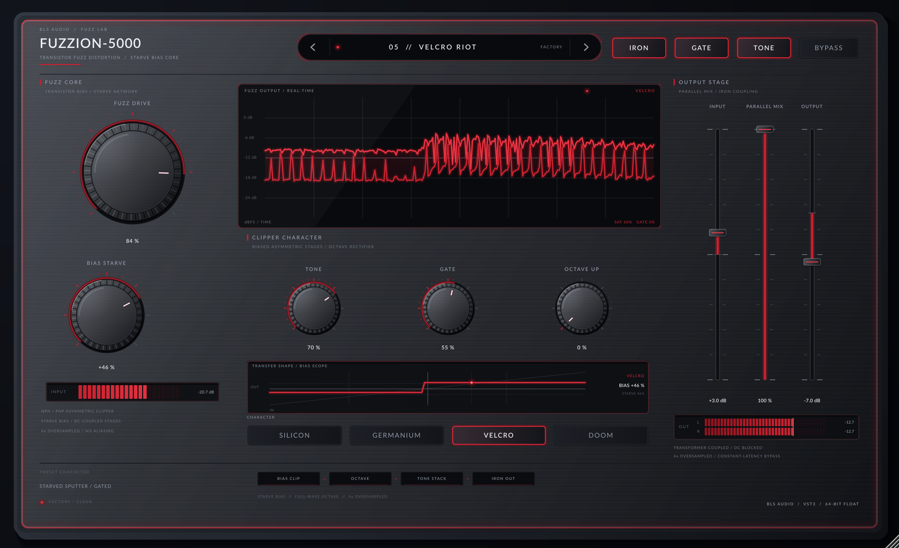

# Fuzzion-5000

Fuzzion-5000 is a distinctly modern transistor fuzz distortion: a biased, asymmetric
two-stage clipper with a starve-bias network, a full-wave octave rectifier, a
character tone stack, a musical noise gate and an iron output transformer. It runs
every non-linear stage at 4x oversampling and mixes dry/wet inside the oversampled
domain, so bypass is perfectly latency-matched.

Built with JUCE 8.0.8 and CMake. Formats: **VST3** and **Standalone** (Linux, macOS
Universal, Windows x64).



## Controls

| Control | Range | What it does |
| :--- | :--- | :--- |
| **Input** (slider) | -18…+18 dB | Input trim into the fuzz core |
| **Fuzz Drive** | 0…100 % | Pre-gain into the clipper (1.2x to 31x) |
| **Bias Starve** | -100…+100 % | Offsets the clipper operating point; asymmetric clipping, gating and sputter |
| **Tone** | 0…100 % | Tilt EQ around 700 Hz plus a tone-dependent low-pass ceiling |
| **Gate** | 0…100 % | Gate threshold (-58 dB to -14 dB) |
| **Octave Up** | 0…100 % | Full-wave rectifier blend for upper-octave fuzz |
| **Mix** (slider) | 0…100 % | Parallel dry/wet inside the oversampled domain |
| **Output** (slider) | -24…+12 dB | Output level |

Tactile buttons: **BYPASS**, **TONE** (tone stack in/out), **GATE** (gate on/off) and
**IRON** (output transformer saturation). Four transistor characters are selectable
from the front panel: **SILICON**, **GERMANIUM**, **VELCRO** and **DOOM**.

Ten factory presets cover classic fuzz, octave lead, starved velcro, doom sludge,
bass fuzz, gated lo-fi and parallel grit.

## Build (offline Linux)

```bash
./scripts/setup-linux.sh   # symlinks the local JUCE 8.0.8 and sysroot caches
./scripts/build.sh         # configures + builds Release, stages dist/
```

## Verification

```bash
./build/Fuzzion5000Tests_artefacts/Release/Fuzzion5000Tests
./build/Fuzzion5000HostSmokeTest_artefacts/Release/Fuzzion5000HostSmokeTest dist/Fuzzion-5000.vst3
xvfb-run -a ./build/Fuzzion5000Screenshot_artefacts/Release/Fuzzion5000Screenshot --out=dist/fuzzion5000-ui.png
```

## Design notes

- **Zero allocation / no locks on the audio thread.** Parameters are read once per
  block through raw atomics; waveform telemetry uses a fixed 1024-column atomic
  ring buffer.
- **Constant latency.** Dry and wet are summed at 4x before the down-sampler, so
  host latency is reported once and never changes with bypass or mix.
- **Real-time safe metering.** Input peak, output L/R peaks, clipper saturation and
  gate reduction are published through `std::atomic<float>`.
- **Sleek futuristic studio hardware.** Brushed gunmetal chassis, flush screwless
  glass with a crimson LED edge-glow, knurled low-profile knobs, ultra-thin glass
  sliders, a central glowing waveform scope and a live transfer/bias scope.

## Licence

JUCE is used under its own licence; see `Resources/Lato-OFL.txt` for the bundled
Lato typeface family.
